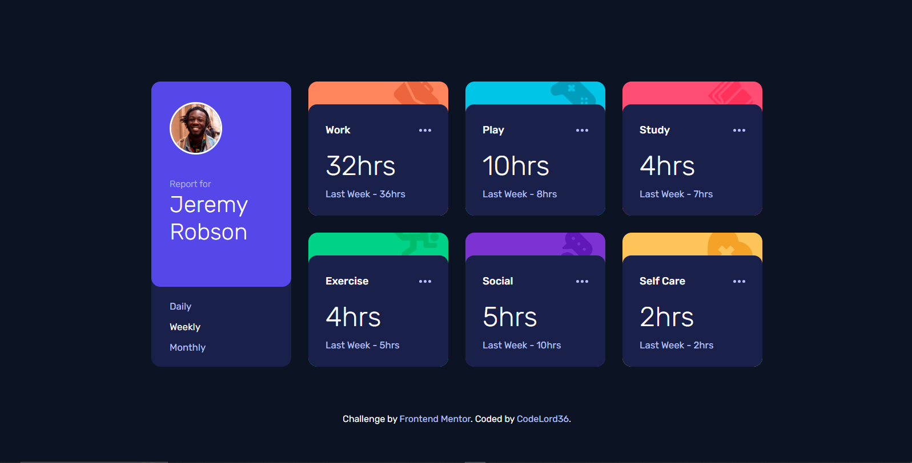
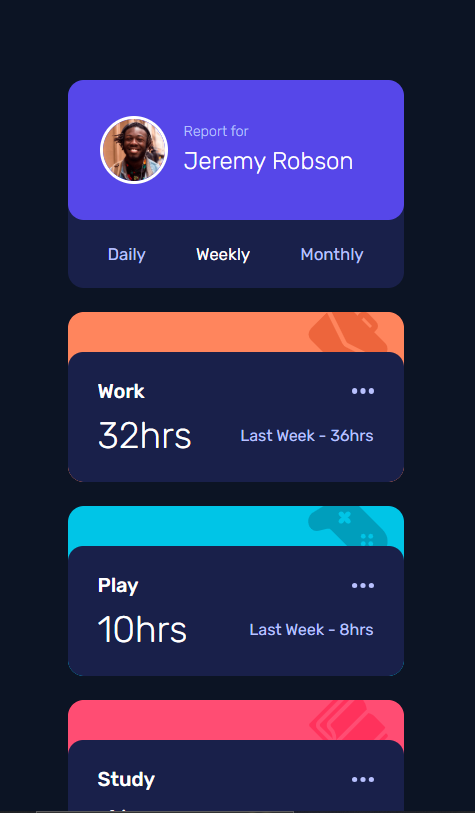

# Frontend Mentor - Time tracking dashboard solution

This is a solution to the [Time tracking dashboard challenge on Frontend Mentor](https://www.frontendmentor.io/challenges/time-tracking-dashboard-UIQ7167Jw). This project provided an opportunity to practise CSS Grid, responsive layouts, and JavaScript data manipulation using JSON.

## Table of contents

- [Frontend Mentor - Time tracking dashboard solution](#frontend-mentor---time-tracking-dashboard-solution)
  - [Table of contents](#table-of-contents)
  - [Overview](#overview)
    - [The challenge](#the-challenge)
    - [Screenshot](#screenshot)
      - [Desktop View](#desktop-view)
      - [Mobile View](#mobile-view)
    - [Links](#links)
  - [My process](#my-process)
    - [Built with](#built-with)
    - [What I learned](#what-i-learned)
    - [Continued development](#continued-development)
    - [Useful resources](#useful-resources)
    - [AI Collaboration](#ai-collaboration)
  - [Author](#author)
  - [Acknowledgments](#acknowledgments)

## Overview

### The challenge

Users should be able to:

- View the optimal layout for the dashboard depending on their device's screen size.
- See hover states for all interactive elements on the page.
- Switch between viewing Daily, Weekly, and Monthly activity statistics.
- View updated activity hours and previous-period information when switching between timeframes.

### Screenshot

#### Desktop View



#### Mobile View



### Links

- Solution URL: [GitHub Repository](https://github.com/CodeLord36/time-tracking-dashboard)
- Live Site URL: [View Live Site](https://time-tracking-dashboard-five-ochre.vercel.app/)

## My process

### Built with

- Semantic HTML5 markup
- SCSS (Sass) for styling
- CSS Grid for the dashboard layout
- Flexbox for component alignment
- CSS custom properties
- Vanilla JavaScript (ES6+)
- JSON for storing and retrieving activity data
- Fetch API for asynchronous data retrieval
- Vite for development and build tooling
- Google Fonts (Rubik)
- Mobile-first workflow
- BEM naming convention for CSS class organisation

### What I learned

This project helped me strengthen my understanding of CSS Grid, SCSS, and Vanilla JavaScript, particularly when working with external JSON data and dynamically updating the DOM.

Some of the key concepts I practised include:

**1. Fetching JSON Data**

I used the Fetch API with `async/await` to retrieve activity information from the JSON file and make it available to the application.

```javascript
const response = await fetch("/data.json");

if (!response.ok) {
  throw new Error("Failed to fetch dashboard data");
}

const data = await response.json();
```

**2. DOM Manipulation**

I learned how to select HTML elements and update their content dynamically using JavaScript.

```javascript
const activityCards = document.querySelectorAll(".activity-card");

activityCards.forEach((card) => {
  const activityName = card.dataset.activity;

  // Update activity information
});
```

**3. Array Methods**

I practised using `forEach()` to iterate through DOM elements and `find()` to retrieve matching activity objects from the JSON data.

```javascript
const activity = data.find((item) => item.title === activityName);
```

**4. Object Destructuring and Dynamic Property Access**

I learned how to extract properties from nested objects using destructuring and access object properties dynamically using bracket notation.

```javascript
const { current, previous } = activity.timeframes[timeframe];
```

This made it possible to retrieve the appropriate activity statistics based on the selected timeframe without duplicating code.

**5. Event Listeners**

I implemented `addEventListener()` to handle timeframe button interactions and update the dashboard whenever a user selects Daily, Weekly, or Monthly.

```javascript
button.addEventListener("click", () => {
  const selectedTimeframe = button.dataset.timeframe;

  renderDashboard(data, selectedTimeframe);
});
```

**6. Responsive Layouts with CSS Grid**

I further practised CSS Grid to organise the activity cards into a responsive dashboard layout that adapts to different screen sizes.

### Continued development

Going forward, I want to continue improving my understanding and practical application of:

- Advanced JavaScript concepts, including array methods, object manipulation, and asynchronous programming.
- Writing cleaner and more reusable JavaScript functions.
- Improving DOM manipulation techniques and event handling.
- Building more complex responsive layouts using CSS Grid and Flexbox.
- Exploring more efficient ways to structure and organise SCSS stylesheets.

I also want to keep building projects that involve working with external data and creating interactive user interfaces without relying on JavaScript frameworks.

### Useful resources

- [MDN Web Docs - Fetch API](https://developer.mozilla.org/en-US/docs/Web/API/Fetch_API) - Helped me understand how to retrieve data from JSON files using the Fetch API.
- [MDN Web Docs - Array Methods](https://developer.mozilla.org/en-US/docs/Web/JavaScript/Reference/Global_Objects/Array) - Useful for understanding array methods such as `forEach()` and `find()`.
- [MDN Web Docs - Destructuring](https://developer.mozilla.org/en-US/docs/Web/JavaScript/Reference/Operators/Destructuring) - Helped me understand how to extract values from JavaScript objects.
- [MDN Web Docs - Event Listeners](https://developer.mozilla.org/en-US/docs/Web/API/EventTarget/addEventListener) - Helped me implement interactive timeframe selection.
- [Sass Documentation](https://sass-lang.com/documentation/) - Useful for understanding SCSS features and stylesheet organisation.
- [Frontend Mentor](https://www.frontendmentor.io/) - Provided the design challenge and resources for the project.

### AI Collaboration

I used ChatGPT as a learning and development assistant throughout this project.

- Used AI assistance to understand JavaScript concepts and implement the dashboard's dynamic functionality.
- Worked through the process of fetching and handling JSON data using the Fetch API.
- Received guidance on DOM manipulation, array methods, object destructuring, and event listeners.
- Used AI-assisted debugging to identify and resolve issues encountered during implementation, including an incorrect DOM selector that prevented the timeframe buttons from responding.
- Used the interaction as a learning opportunity to understand the underlying concepts rather than simply copying solutions.

Working with AI helped me approach problems more systematically, understand unfamiliar concepts, and improve my debugging skills.

## Author

- GitHub - [@CodeLord36](https://github.com/CodeLord36)
- Frontend Mentor - [@CodeLord36](https://www.frontendmentor.io/profile/CodeLord36)

## Acknowledgments

- [Frontend Mentor](https://www.frontendmentor.io/) - For providing the challenge, design resources, and opportunity to practise frontend development.
- [MDN Web Docs](https://developer.mozilla.org/) - For the documentation and learning resources that supported my JavaScript development.
